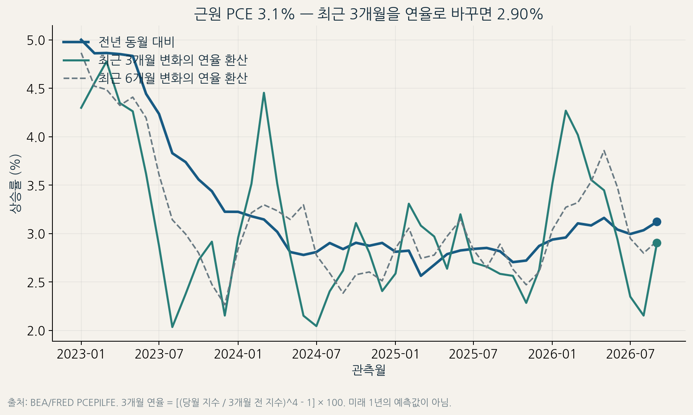

# 펀덕 금융 리서치 · 투자 데이터 포트폴리오

**발표 수치를 그대로 옮기는 대신, 원자료·SQL·Python으로 계산과 해석 범위를 검증하는 연구 저장소입니다.**

| 사례 | 질문 | 현재 확인한 결과 |
| --- | --- | --- |
| [PCE 발표 연구](docs/RESEARCH_MEMO.md) | 같은 발표에서 물가·소비·수정치를 어떻게 구분하는가? | 고정 원자료 재실행, 검사 39개·Notebook 코드 셀 6개 통과 |
| [장기금리 파이프라인](studies/macro_foundations/) | 소스별 날짜·결측을 지키며 금리를 분석할 수 있는가? | 원래 코드·모형 결과 보존, 데이터 보호 검사 4개 현재 실행 |
| [중간선거 사건 연구](studies/midterm_events/) | 연말과 12개월 수익 통계를 같은 근거로 사용할 수 있는가? | 기존 Python·SQL·Notebook·집계 결과 보존. 전체 원자료 재실행은 별도 필요 |



## PCE 연구를 재실행하려면

Python 3.12 환경에서 저장소 루트의 명령을 실행합니다. 기본 실행은 포함된 고정 자료를 검증하며 새 금융 자료를 받지 않습니다.

```bash
python -m venv .venv
source .venv/bin/activate
python -m pip install -r requirements.txt
python run_research.py
python -m unittest discover -s studies/macro_foundations/tests -v
```

SQL은 `(date, series_id)`의 유일 키와 `LAG`, 빈티지 조인을 사용합니다. Python은 같은 값을 별도 계산해 대조합니다. [Notebook](analysis_notebook.ipynb)은 코드 셀을 순서대로 CPython으로 실행한 출력이며 별도 Jupyter 커널 실행을 검증했다는 뜻은 아닙니다.

2026-10-30 복원 실행에서 기존 대조 대상 15개의 SHA-256이 모두 일치했습니다. 기준일과 입력 해시, 실행 환경은 [검증 기록](outputs/restoration_verification.json), [원자료 목록](data/source_manifest.json), [품질 검사](outputs/qa_results.json)에서 확인할 수 있습니다. CI 서버 결과는 저장소의 Actions 실행 기록으로 별도 확인합니다.

## 구조와 연구 범위

| 경로 | 역할 |
| --- | --- |
| `collect_data.py`, `data/` | 정부 원자료 스냅샷·출처·수집 시각·해시 |
| `analysis.sql`, `run_analysis.py` | SQLite 처리·독립 검산·차트 |
| `analysis_notebook.ipynb` | PCE 분석 과정과 실행 출력 |
| `outputs/`, `figures/` | 계산 결과·품질 검사·설명용 시각화 |
| `docs/` | 데이터 사전·자료 권리·방법·해석 한계 |
| `studies/` | 앞선 금리 파이프라인과 중간선거 연구의 공개 사본 |

[7개 연구 영역·10단계 방법론](docs/METHODOLOGY_STATUS.md)에 실제 적용 범위를 연결했습니다. 현재 자료는 수정 시계열을 포함하며 실시간 예측 초과성과, 독립된 미사용 테스트, 실제 운용 실적을 입증하지 않습니다. 실제 증권 주문은 수행하지 않습니다.

정부 통계와 NanumGothic은 [출처·공개 범위](docs/DATA_RIGHTS.md) 및 동봉한 글꼴 라이선스를 따릅니다. 사건 연구의 민간 원자료는 재배포하지 않습니다. 비공개 작업 인계·사용자 합의 원문은 이 저장소의 공개 대상에 포함하지 않았습니다.

기존 공개 블로그: [미국 10년물 국채금리 5.13%, 성장주 지금 사도 될까?](https://blog.naver.com/fire_road/224450612998). 이 링크는 이미 발행된 글이며 이번 복원에서 새로 발행했다는 뜻은 아닙니다.

코드·문서·분석 제작에 AI를 활용했습니다. 채용용으로 활용할 때는 재현 절차와 계산의 한계를 직접 설명할 수 있어야 합니다.
